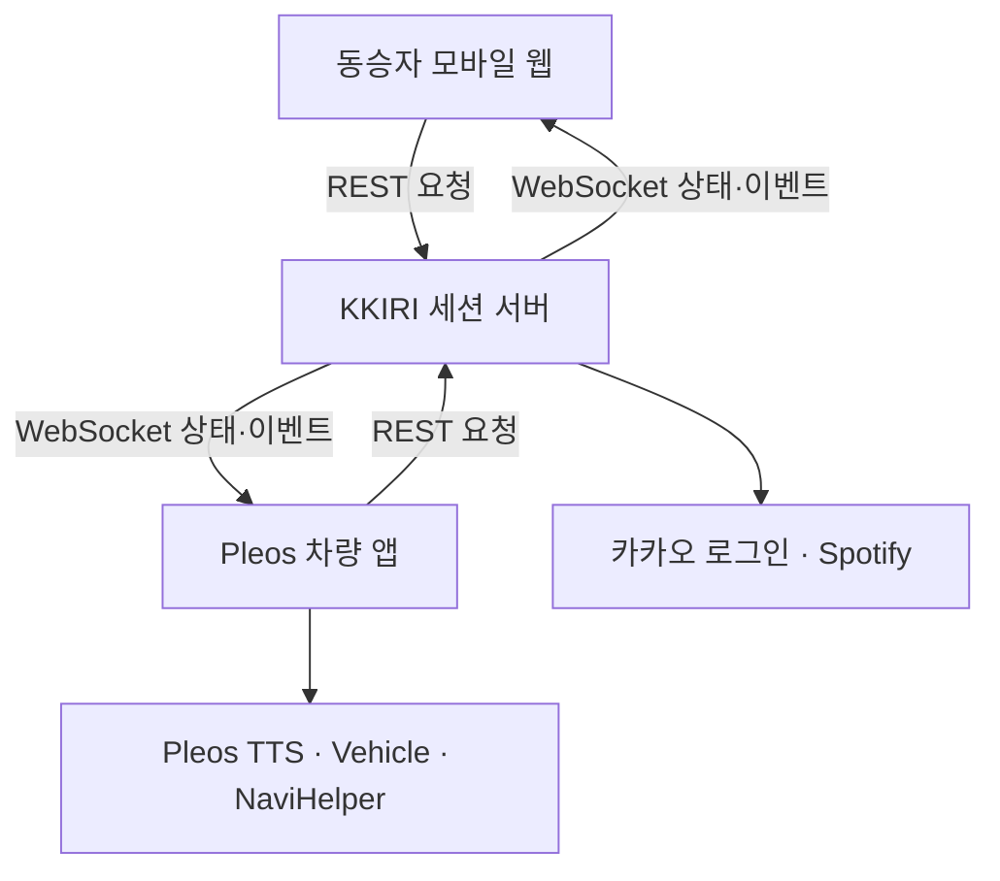

# KKIRI (끼리)

**두 대여도 한 차처럼.**

KKIRI는 함께 이동하는 Pleos 차량과 동승자를 하나의 일행으로 연결합니다. 동승자는 앱 설치 없이 QR로 합류해 메시지를 보내고, 들를 곳과 음악을 고릅니다. 차량은 메시지와 변경 사항을 읽어주고, 일행 차량은 6자리 접속코드로 모입니다.

| 항목 | 내용 |
|---|---|
| 공모전 | 현대자동차그룹 차량용 앱 개발 공모전 · Pleos Connect |
| 팀 | OKKIKKI |
| 앱 버전 | `0.1.0` |
| 구성 | AAOS 차량 앱 · 동승자 모바일 웹 · 세션 서버 |

### 시연 영상

차량 두 대와 동승자 휴대폰 한 대로 QR 합류, 차량 간 소통, 경유지 제안, 음악 대기열 추가를 보여줍니다.

▶ **[시연 영상 보기 (Google Drive)](https://drive.google.com/file/d/1t39sDGqGukPX4RKMDjvrmnzsNmc4bFDK/view?usp=drivesdk)**

영상에서 운전자 명령·시동 입력은 에뮬레이터용 디버그 패널로 재현했습니다. 실제 음성 인식 연동은 [향후 구현 계획](#5-향후-구현-계획)에 있습니다.

### APK와 실행 환경

| 항목 | 내용 |
|---|---|
| 제출 APK | [OKKIKKI_KKIRI_release.apk](apk/OKKIKKI_KKIRI_release.apk) |
| 에뮬레이터 | Pleos Connect v2.1.0 · 2560×1440 · API 34 |
| APK 빌드 설정 | 서버 주소 `http://10.0.2.2:8080` · 차량 ID `dev-0001` · 시연용 명령·주행 패널 포함 |
| 서버 연결 | 에뮬레이터를 실행하는 PC에서 백엔드를 먼저 띄웁니다. 동승자 폰을 함께 쓰려면 서버의 `KKIRI_WEB_BASE`를 폰에서 접속할 수 있는 웹 주소로 설정합니다. |
| 시연 범위 | 제출 APK 한 개로 세션 생성, 동승자 QR 합류, 메시지 낭독, 주행 화면 전환, 패널을 통한 운전자 명령을 확인할 수 있습니다. 차량 2대 시연에는 차량 ID가 다른 APK가 하나 더 필요합니다([소스 빌드](#1-심사자-실행-방법)). |

[심사자 실행 방법](#1-심사자-실행-방법) · [시연 절차](#7-시연-절차) · [기능 명세서](#3-기능-명세서) · [향후 구현 계획](#5-향후-구현-계획)

## 1. 심사자 실행 방법

**첫 확인 순서**는 백엔드 실행 → 동승자 웹 실행 → APK 설치 → 세션 생성과 메시지 낭독입니다. 제출 APK를 사용하는 경우 차량 앱을 다시 빌드할 필요가 없습니다.

**준비물**은 Pleos Connect v2.1.0 에뮬레이터(API 34, 2560×1440), Android SDK Platform-Tools(`adb`), Node.js(팀 테스트 기준 24.x)입니다. 아래 절차는 **기본 서버 주소 `http://10.0.2.2:8080`으로 빌드한 APK**를 같은 PC의 에뮬레이터에서 실행하는 경우를 기준으로 합니다.

### ① 백엔드 실행

저장소 루트에서 PowerShell 터미널을 엽니다.

```powershell
cd backend
if (-not (Test-Path .env)) { Copy-Item .env.example .env }
npm ci
npm run dev
```

브라우저에서 [서버 상태 확인](http://localhost:8080/health)을 열어 `"status":"ok"`가 표시되는지 확인합니다.

### ② 동승자 웹 실행

별도 터미널을 저장소 루트에서 엽니다.

```powershell
cd web
if (-not (Test-Path .env)) { Copy-Item .env.example .env }
npm ci
npm run dev
```

예제 설정의 웹 주소는 `http://localhost:5173`입니다. macOS·Linux에서는 양쪽의 `.env` 생성 줄 대신 `test -f .env || cp .env.example .env`를 사용합니다.

### ③ 제출 APK 설치와 첫 동작 확인

Pleos 에뮬레이터를 실행한 뒤 저장소 루트에서 설치합니다.

```powershell
adb install apk/OKKIKKI_KKIRI_release.apk
```

여러 기기가 연결돼 있으면 `adb devices`로 대상 ID를 확인해 `adb -s <기기 ID> install apk/OKKIKKI_KKIRI_release.apk`를 사용합니다.

1. 에뮬레이터에서 KKIRI를 열고 정차 상태에서 세션을 만듭니다. QR과 6자리 접속코드가 표시됩니다.
2. QR의 전체 주소를 PC 브라우저에서 열고, 동승자 이름을 입력해 합류합니다. 실제 휴대폰으로 QR에 접속할 때는 아래의 **실제 휴대폰 연결** 설정을 먼저 적용합니다.
3. 동승자 웹에서 메시지를 보내고 차량에서 낭독되는지 확인합니다. 기어를 D로 전환하면 KKIRI 주행 화면으로 바뀌고 일반 탭이 잠깁니다.

운전자 명령 패널은 주행 화면에서, 수동 주행·시동 버튼은 화면 오른쪽 아래에 표시됩니다. 차량 2대 합류와 명령 순서는 [전체 시연 절차](#7-시연-절차)에서 확인할 수 있습니다.

<details>
<summary>실제 휴대폰으로 QR에 접속하기</summary>

휴대폰과 서버 PC를 같은 네트워크에 연결합니다. 아래 `192.168.0.10`은 예시이며, 실제 서버 PC의 LAN IPv4 주소로 바꿉니다.

`backend/.env`에서 다음 값을 설정합니다.

```dotenv
PORT=8080
KKIRI_WEB_BASE=http://192.168.0.10:5173
KKIRI_API_BASE=http://192.168.0.10:8080
DEV_LOGIN=1
SPOTIFY_CLIENT_ID=
SPOTIFY_CLIENT_SECRET=
```

`web/.env`에서 다음 값을 설정합니다.

```dotenv
KKIRI_API_BASE=http://192.168.0.10:8080
KKIRI_WS_BASE=ws://192.168.0.10:8080
VITE_USE_MOCK=0
```

백엔드와 웹을 재시작하고, 휴대폰에서 `http://192.168.0.10:5173`에 접속되는지 확인합니다. 차량에서 새 세션을 만든 뒤 QR을 스캔합니다. 에뮬레이터의 기본 APK 서버 주소 `10.0.2.2:8080`은 그대로 사용합니다.

</details>

<details>
<summary>차량 2대와 디버그 명령 재현용 소스 빌드</summary>

빌드 환경은 Android Studio, JDK 21, Android SDK 34, Gradle 8.9, AGP 8.7.2, Kotlin 2.0.21입니다. 앱의 compile·target SDK는 34, min SDK는 29입니다.

Android Studio에서 `car-app/`을 열고 SDK 경로와 Gradle JDK를 설정합니다. 두 에뮬레이터를 시작한 뒤 기기 ID를 확인합니다.

```powershell
adb devices
```

아래 `emulator-5554`, `emulator-5556`은 예시이며 실제 목록의 기기 ID로 바꿉니다. A차 빌드 결과를 먼저 A차에 설치한 다음 B차를 빌드합니다.

```powershell
cd car-app

# A차: 빌드 후 즉시 A차에 설치
.\gradlew.bat :app:assembleDebug "-Pkkiri.deviceId=demo-car-a" "-Pkkiri.carDisplayName=A차" "-Pkkiri.driverName=드라이버A" "-Pkkiri.apiBase=http://10.0.2.2:8080" "-Pkkiri.debugPanels=true"
adb -s emulator-5554 install -r app/build/outputs/apk/debug/app-debug.apk

# B차: 다른 deviceId로 다시 빌드 후 B차에 설치
.\gradlew.bat :app:assembleDebug "-Pkkiri.deviceId=demo-car-b" "-Pkkiri.carDisplayName=B차" "-Pkkiri.driverName=드라이버B" "-Pkkiri.apiBase=http://10.0.2.2:8080" "-Pkkiri.debugPanels=true"
adb -s emulator-5556 install -r app/build/outputs/apk/debug/app-debug.apk
```

차량 두 대를 시연하려면 **서로 다른 `deviceId`가 들어간 APK 두 개**를 설치합니다. 동일 ID는 서버에서 한 차량으로 처리됩니다.

| Gradle 속성 | 용도 |
|---|---|
| `kkiri.apiBase` | 차량 앱의 서버 주소 · 기본 `http://10.0.2.2:8080` |
| `kkiri.wsBase` | 별도 WebSocket 주소 · 생략하면 API 주소에서 자동 변환 |
| `kkiri.deviceId` | 차량별 고유 식별값 |
| `kkiri.carDisplayName` | 차량 표시 이름 |
| `kkiri.driverName` | 운전자 표시 이름 |
| `kkiri.useMock` | `true`면 차량 앱의 서버 연결을 목업 저장소로 전환 · 기본 `false` |
| `kkiri.debugPanels` | `true`면 debug 빌드에 명령·주행 패널 표시 · 기본 `false` |
| `kkiri.realNavi` | `false`면 Pleos 내비 대신 목업 내비 사용 · 기본 `true` |

이 값은 `-P` 또는 `gradle.properties`로 지정하는 **빌드 속성**입니다. 서버 주소를 변경하면 APK를 다시 빌드합니다.

위 소스 빌드 예시는 명령·시동 패널을 사용하기 위한 **debug 빌드**입니다.

</details>

<details>
<summary>카카오·Spotify 계정 연동과 세션 미리 열기 설정</summary>

| 기능 | 설정 |
|---|---|
| 개발용 로그인 | `DEV_LOGIN=1` · 카카오 키 유무와 관계없이 개발 로그인이 우선 |
| 카카오 로그인 | `DEV_LOGIN=0`, `KAKAO_REST_API_KEY`, 필요 시 `KAKAO_CLIENT_SECRET` 설정. 콜백 경로는 `/v1/auth/kakao/callback` |
| Spotify | `SPOTIFY_CLIENT_ID`와 `SPOTIFY_CLIENT_SECRET`을 모두 설정하면 실제 어댑터 선택. 콜백 경로는 `/v1/music/spotify/callback` |
| 폰에서 세션 미리 열기 | `backend/seed/users.json`의 계정별 `deviceIds`와 차량 앱 `kkiri.deviceId`가 일치해야 함 |

실제 OAuth 연결에는 각 서비스 콘솔의 Redirect URI와 외부 접속 주소(`KKIRI_API_BASE`) 설정이 필요합니다. Spotify는 Redirect URI로 HTTPS 또는 `http://127.0.0.1:8080`만 허용하므로 LAN http 주소로는 실제 연동되지 않습니다. HTTPS 환경에서는 웹의 WebSocket 주소도 `wss://`로 맞춥니다.

</details>

## 2. 기획 배경과 타깃

차 두 대로 여행할 때 “다음 휴게소에서 쉬자”는 한마디도 전화나 단체 대화방을 거칩니다. 경유지를 바꾸면 각 차량이 내용을 확인하고 경로를 다시 입력해야 합니다. 한 차에서도 뒷자리 동승자가 음악이나 경유지를 고르려면 운전자에게 부탁하는 일이 생깁니다. KKIRI는 동승자의 휴대폰을 입력 화면으로, 차량의 스피커를 일행과 소통하는 수단으로 사용합니다.

팀은 Pleos Connect 탑재 차량을 빌려 이용 환경을 체험하고, 11월 4~6일 온라인 설문을 진행했습니다. 유효 응답 96명 중 43명(44.8%)이 ‘함께 이동하는 차끼리 위치를 공유하고 음성으로 소통’하는 앱을 선택했습니다. 최대 2개를 고르는 관심도 문항이며, 20대가 표본의 61.5%를 차지합니다. 차량 체험과 설문은 기획 근거이며, 조작 횟수와 재사용 의향은 후속 테스트에서 측정합니다.

주 타깃은 차 1~3대로 함께 여행하는 20·30대 친구·연인입니다. 주말 가족 이동처럼 한 차 안에서 뒷자리도 경유지나 음악을 고르고 싶은 상황으로 사용 범위를 넓힐 수 있습니다.

## 3. 기능 명세서

상태는 기준 소스에 연결된 동작을 나타냅니다. **구현**은 앱이나 서버에 기능이 연결된 상태, **시연용 대체**는 디버그 입력·샘플·고정 데이터가 필요한 상태입니다. **연동 코드 있음**은 외부 API를 호출하는 코드가 있으며 실계정이나 대상 환경에서 확인이 남았다는 뜻입니다. 실행 확인 근거는 [검증 기록](#8-검증-기록)에 정리했습니다.

### 세션과 참여

| 기능 | 동작 명세 | 현재 상태 |
|---|---|---|
| 세션 생성 · QR 입장 · 차량 합류 | 정차한 호스트 차량이 세션을 생성합니다. 동승자는 QR을 열어 이름을 입력하고, 다른 차량은 6자리 코드를 입력합니다. QR 만료 기본값은 30분입니다. | 구현 |
| 운전자 로그인 · 세션 미리 열기 | 폰에서 연결된 차량의 세션을 미리 열고, 동승자가 출발 전에 입장해 경유지를 추가합니다. | 구현. 카카오 실계정 확인 기록이 있으며 개발 로그인으로도 재현할 수 있습니다. 계정과 차량 연결, 친구 차량은 시드 데이터를 사용합니다. |
| 일시정지 · 다시 연결 | 서버가 호스트의 시동 OFF를 받으면 일시정지하고, 유효한 세션으로 재접속하면 이어집니다. 통신이 끊긴 차량의 연결 복귀도 처리합니다. | 서버·재연결 구현 / 시동 신호는 디버그 입력 |
| 종료 · 주행 요약 | 호스트가 종료하면 등록 경유지, 참여 차량, 세션의 곡 수를 폰 웹에 표시합니다. 기본값은 무로그인 세션 시동 OFF 후 15분간 입력이 없거나, 계정 세션의 마지막 활동 후 24시간이 지나면 종료하는 방식입니다. | 구현. 등록 경유지 목록을 집계하며, 목업 음악은 목업 상태로 집계합니다. |

### 메시지와 차량 간 소통

| 기능 | 동작 명세 | 현재 상태 |
|---|---|---|
| 동승자 메시지 · 낭독 | 폰 웹에서 메시지와 긴급 여부를 전송합니다. 차량은 Pleos TextToSpeech `3.3.1`로 한국어 메시지를 읽습니다. 일반 메시지의 낭독 간격 기본값은 10초입니다. | 구현 · Pleos TTS |
| 차량별 음소거 · 메시지 보관 | 음소거한 차량에서 온 메시지는 보관합니다. 긴급 메시지는 음소거를 통과하며, 해당 차량으로의 긴급 전달은 발신자별 기본 30초에 1건입니다. | 전달·보관 구현 / 음성 명령은 디버그 패널 / 차량 메시지 탭은 샘플 |
| 차량 간 말 전하기 · 무전 | 대상 차량에 텍스트나 최대 15초 클립을 보내고 수신 차량에서 낭독하거나 재생합니다. | 전송·재생 구현 / 디버그 명령과 테스트용 합성 오디오 사용 |
| 운전자 명령과 확인 | 말 전하기, 음소거, 경유지 제안 수락·거절, 되돌리기, 음악 잠금·해제를 처리합니다. 음소거와 경유지 되돌리기는 확인 절차를 거칩니다. | 명령 처리 구현 / 디버그 패널에서 입력 |

### 경유지와 음악

| 기능 | 동작 명세 | 현재 상태 |
|---|---|---|
| 경유지 검색 · 내 차 목록 | 폰에서 장소를 골라 같은 차의 경유지 목록에 추가·삭제합니다. 마지막 경유지 변경을 되돌릴 수 있습니다. | 서버 목록·안내 구현 / 시드 장소 8곳 / 차량 내비 반영은 Pleos NaviHelper 연동 코드 있음 · 실제 경로 반영 검증 필요 |
| 다른 차에 경유지 제안 | 다른 차량에 제안을 전달하고, 해당 차량이 수락하면 그 차량의 목록을 갱신합니다. 무응답 시 기본 60초 후 만료됩니다. | 제안·응답·만료 구현 / 응답 입력은 디버그 패널 / 수락 후 내비 반영은 NaviHelper 연동 코드 있음 · 검증 필요 |
| 음악 공유와 잠금 | 폰 웹에서 곡을 골라 호스트가 세션에 연결한 Spotify 계정의 다음 곡 대기열에 넣거나 재생 상태를 제어합니다. 운전자 측에서 해당 세션의 음악 조작을 잠그고 풀 수 있습니다. | 서버·웹·차량 알림 구현 / Spotify 연동 코드 있음 · 실계정 재생 검증 미확인. 키가 없으면 고정 곡 10개로 시연 |

### Pleos 차량 화면과 장치 연동

| 기능 | 동작 명세 | 현재 상태 |
|---|---|---|
| 주행·정차 화면 | Pleos Vehicle `2.3.2`에서 기어를 받아 P단과 주행 화면을 전환합니다. 주행 화면에서 일반 탭을 잠그고 정차용 움직임을 멈춥니다. | SDK 연동 구현 · 에뮬레이터 확인 기록 |
| 공간 · 일행 · 꾸미기 | 차량과 탑승자를 표시합니다. 차량 색·캐릭터·소품은 세션으로 공유하며, 광장 배경은 내 화면에 저장합니다. 정차 중에는 핸들 각도를 차량 그림에 반영합니다. | 공유와 각도 반영 구현 · 최신 꾸미기 변경의 최종 차량 빌드·다중 기기 검증 필요 |
| 앰비언트 알림 | 메시지 낭독 시 지원 영역의 조명 색을 바꿨다가 원래 색을 복원합니다. | SDK 연동 구현 · 에뮬레이터 디버그 메시지 확인 기록 · 실차 복원 검증 필요 |
| 좁은 창 · 보조 탭 | 좁은 화면에서 QR·접속코드를 모달로 표시합니다. 지도·메시지 탭은 샘플 화면을 제공하며 설정과 일부 편집 버튼은 ‘준비 중’으로 표시합니다. | QR 모달 구현 / 지도·메시지 탭은 시연용 대체 / 일부 화면 후속 |

REST 응답·WebSocket 이벤트의 예시 데이터는 [docs/fixtures/](docs/fixtures/)에 있으며, 서버 계약 테스트와 차량 앱 목업이 이 파일을 함께 사용합니다.

## 4. 주요 사용 시나리오

| 상황 | 현재 시연 가능한 흐름 | 후속 연동 후 목표 경험 |
|---|---|---|
| 친구 5명이 차 2대로 강릉 여행 | A차가 “강릉 여행” 세션을 엽니다. 친구들은 QR로, B차는 코드로 합류합니다. A차 뒷자리에서 휴게소를 골라 B차에 제안하면 차량이 이를 읽어줍니다. B차가 명령 패널에서 수락하면 경유지 목록이 바뀌고 NaviHelper로 경로 요청을 보냅니다. 도착하면 폰에 요약이 뜹니다. | B차 운전자가 말로 제안을 수락하고, 두 차량의 실제 경로에 경유지가 반영된 것을 확인합니다. 휴게소에서 시동을 껐다 켜면 같은 세션으로 복귀합니다. |
| 가족이 차 1대로 주말 외식 | 뒷자리 자녀가 QR로 접속해 곡을 대기열에 넣습니다. 차량이 대기열에 추가된 곡을 안내하고, 운전자 패널에서 잠그면 폰의 음악 버튼이 비활성화됩니다. 로컬 시연은 목업 음악을 사용합니다. | 호스트가 연결한 Spotify의 재생 대기열이 갱신되고, 운전자가 말로 음악 조작을 잠그거나 풉니다. |

## 5. 향후 구현 계획

### 2차 발표 전 목표 · 12월 2일까지

| 계획 | 구현할 내용 | 확인 기준 |
|---|---|---|
| 음성 명령 | Pleos SpeechToText를 기존 명령 처리에 연결합니다. 말 전하기·듣기 제어·변경 응답을 처리하고, 확인 응답과 시간 초과를 연결합니다. | 운전자가 화면을 누르지 않고 제안을 수락·거절하고 음악을 잠급니다. 응답이 없으면 확인 대상 명령이 실행되지 않습니다. |
| 내비게이션 검증 | NaviHelper `3.0.5` 연동 코드로 같은 차의 경유지 변경, 다른 차의 수락 결과, 공유 목적지가 각 차량 경로에 반영되는지 검증하고 보완합니다. | A차 경유지 추가와 B차 제안 수락을 각각 실제 경로에서 확인합니다. 거절·만료 시 B차 경로를 유지합니다. |
| 시동 신호·복귀 | 실제 시동 상태를 받을 수 있는 API와 권한을 확인한 뒤 일시정지·재접속으로 연결합니다. 기어·핸들 연동은 검증을 이어갑니다. | 시동 OFF/ON과 네트워크 단절·복구를 각각 재현해 세션 상태를 확인합니다. 기어를 확인할 수 없을 때도 화면 입력 제한을 점검합니다. |
| 위치 기반 장소 검색·일행 위치 | FusedLocation으로 차량 위치를 받아 장소 검색에 적용합니다. 위치 공유와 ETA는 권한·경로 계산 가능 범위를 확인해 연동합니다. | 차량 위치가 검색 기준에 반영됩니다. 위치 권한을 허용한 차량의 위치와 ETA 표시를 확인합니다. |
| 차량 간 녹음 | 마이크 권한을 확인해 차간 클립을 연동합니다. 제한될 경우 STT로 변환한 텍스트를 보내고 수신 차량의 TTS로 읽습니다. | 실제 발화가 B차에서 클립 또는 낭독으로 전달됩니다. |
| Spotify 실계정 검증 | 호스트 계정에서 검색, 대기열 추가, 재생 제어를 확인합니다. | 실제 재생 기기의 대기열에 곡이 추가되고, 잠금 시 동승자 조작이 제한됩니다. |
| 통합 검증 | 에뮬레이터 2대와 실제 폰에서 합류·소통·경유지·음악·종료를 반복합니다. | 첫 합류 시간, 주행 구간 화면 터치 수, 재사용 의향을 기록합니다. |

12월 2일은 신청서의 **목표일**입니다. SDK 권한과 대상 기기 지원 여부에 따라 장소·위치, 실제 녹음의 범위를 조정합니다. Gleo App Schema는 음성 명령의 등록 방식 후보로 검토합니다.

### 2차 기능 후보

핸들 버튼으로 다른 차량에 송신하고 실시간으로 무전하는 기능을 검토합니다. 버튼 이벤트 접근 권한과 차량 지원 범위를 확인한 뒤 개발합니다.

### 이후 제품 확장

| 단계 | 후보 기능 |
|---|---|
| 출시 이후 | 자주 함께 가는 일행 저장, 친구 차량 초대, 주행 요약 보관 |
| 차량 데이터 활용 | 배터리 잔량이 낮은 차량을 기준으로 충전소 제안, 연속 주행 시간에 따른 휴게소 제안. 필요한 Vehicle SDK 데이터 접근 가능 여부부터 확인합니다. |
| 사용처 확대 | 동호회·캠핑·출장 차량, 카셰어링·렌터카 동행, 휴게소·카페 제휴 |

재사용 지표는 **다음 동행에서 같은 앱으로 세션을 다시 여는 비율**입니다. 신청서의 35%는 검증할 목표값입니다.

## 6. 시스템 구성



| 구성 | 기술 | 역할 |
|---|---|---|
| 차량 앱 | Kotlin · Android Views · Coroutines · OkHttp | 세션 화면, 주행 상태 반영, 낭독, 명령 처리, 차량 꾸미기 |
| 모바일 웹 | React `18.3.1` · TypeScript · Vite `5.4.11` | QR 입장, 메시지 입력, 경유지 제안, 음악 제어, 요약 |
| 서버 | Node.js · TypeScript `5.6.3` · `ws` `8.18.0` | 인증, 세션 수명 관리, 데이터 처리, 실시간 이벤트 중계 |
| 저장 | 서버 메모리 · 일부 기기 로컬 저장 | 시연용 세션 상태와 차량 꾸미기 유지 |

상태 변경은 REST, 상태 알림은 WebSocket으로 분리했습니다. 공유 계약의 예시 데이터는 [docs/fixtures/](docs/fixtures/)에 있습니다. 서버를 재시작하면 세션·차량 등록·토큰이 초기화됩니다.

### Pleos 활용

| 기술 | 적용 기능 | 코드 |
|---|---|---|
| Pleos TextToSpeech `3.3.1` | 동승자 메시지와 경유지·음악 변경 안내를 차량에서 한국어로 낭독 | [TTS 구현](car-app/app/src/main/java/com/okkikki/kkiri/voice/tts/) |
| Pleos Vehicle `2.3.2` | 기어에 따른 주행 화면 전환, 정차 중 핸들 각도 반영, 메시지 낭독 시 지원되는 앰비언트 조명 알림 | [기어·핸들](car-app/app/src/main/java/com/okkikki/kkiri/state/PleosVehicle.kt) · [조명](car-app/app/src/main/java/com/okkikki/kkiri/state/PleosAmbientLight.kt) |
| Pleos NaviHelper `3.0.5` | 경유지 추가·삭제·되돌리기와 다른 차 제안 수락 결과를 차량 내비 경로 요청으로 전달, 현재 목적지 조회 | [내비 연동](car-app/app/src/main/java/com/okkikki/kkiri/navi/PleosNaviAdapter.kt) |
| AAOS 주행 화면 | `distractionOptimized` 선언, 주행 상태에서 일반 탭 잠금 | [매니페스트](car-app/app/src/main/AndroidManifest.xml) · [화면 전환](car-app/app/src/main/java/com/okkikki/kkiri/ui/MainActivity.kt) |

## 7. 시연 절차

제출 APK 한 개로는 **세션 생성 → QR 입장 → 메시지 낭독 → 주행 전환 → 패널 명령**까지 확인할 수 있습니다. 차량 간 흐름(1·3·4단계)은 차량 ID가 다른 B차 APK를 추가로 설치해 재현합니다.

| 순서 | 조작 | 확인할 결과 |
|---|---|---|
| 1 | A차에서 세션 생성 → 폰 QR 입장 → B차 접속코드 입력 | 두 차량과 동승자가 한 일행에 표시됩니다. 차량 2대 재현에는 서로 다른 `deviceId`가 필요합니다. |
| 2 | Virtual Console에서 D단으로 전환 → 폰으로 메시지 전송 | KKIRI가 주행 화면으로 전환되고 일반 탭이 잠깁니다. 메시지를 낭독하며, 지원 환경에서는 조명도 바뀝니다. |
| 3 | A차에서 말 전하기·무전 명령 실행 | B차에서 텍스트 낭독과 테스트용 클립 재생을 확인합니다. 명령은 **명령 패널**로 입력합니다. |
| 4 | 폰에서 장소를 골라 다른 차에 제안 → B차에서 수락 | A차 경유지 목록은 바로 갱신되고, B차 목록은 수락 후 갱신됩니다. B차 수락은 **명령 패널**로 입력합니다. 경유지 변경은 NaviHelper로 에뮬레이터 내비 서비스에 경로를 요청합니다. |
| 5 | 폰에서 목업 음악 연결 → 곡 추가 → 호스트 차량에서 음악 잠금 | 대기열이 갱신됩니다. 음악 잠금은 **명령 패널**로 입력합니다. |
| 6 | 정차 → 꾸미기와 핸들 각도 변경 → 호스트에서 세션 종료 | 차량 표현·공유 흐름과 폰 웹의 주행 요약을 확인합니다. |

수동 주행 버튼이 필요하면 디버그 패널에서 ‘실차값 끔’을 선택합니다. 명령 패널은 주행 화면에서 표시됩니다. 특정 차량을 선택할 때는 실제 세션의 `carId`를 사용합니다.

## 8. 검증 기록

| 대상 | 저장소 기록 |
|---|---|
| 서버 | 차량 꾸미기 확장을 포함한 계약·회귀 테스트 18묶음 통과. HTTP·WebSocket 동작을 확인했고, 카카오·Spotify 계약 테스트는 가짜 제공자를 사용했습니다. |
| 웹 | TypeScript 검사와 Vite 빌드 통과 기록이 있습니다. |
| 차량 앱 | 이전 debug·release Kotlin 컴파일, Pleos TTS 출력, V2 기어·핸들·앰비언트와 일부 화면 확인 기록이 있습니다. |
| 추가 검증 범위 | 최신 꾸미기 기능의 다중 기기 동작, 실제 차량에서의 동작, Spotify 실계정 재생 |

표의 결과는 팀이 개발 과정에서 기록한 검증입니다. 11월 15일 제출 소스로 서버 타입 검사, 계약 테스트 18묶음, 웹 빌드를 다시 실행해 모두 통과했습니다. 아래 명령으로 각 검사를 재현할 수 있습니다.

재현할 때는 각각 해당 폴더에서 실행합니다. 계약 테스트는 8080 포트가 비어 있어야 합니다.

| 폴더 | 명령 |
|---|---|
| `backend/` | `npm run typecheck` · `npm run build` · `npm run test:contract` |
| `web/` | `npm run build` |
| `car-app/` | `.\gradlew.bat :app:compileDebugKotlin :app:compileReleaseKotlin` |

## 9. 데이터 처리와 저장소 안내

동승자는 표시 이름으로 입장합니다. 서버가 세션을 종료하면 메시지·클립·비회원 참가자·경유지·제안·세션 토큰을 정리하고 음악 연결을 해제합니다. 계정·등록 차량과 종료를 판별하기 위한 식별 기록은 별도로 관리합니다. 폰 웹의 종료 요약은 브라우저 이동 기록에 남을 수 있습니다.

서버는 메모리 기반 시연 구조입니다. API 키와 시크릿은 서버 `.env`에 설정합니다. 웹의 공개 환경변수는 브라우저 번들에 포함됩니다.

| 위치 | 내용 |
|---|---|
| [car-app/](car-app/) | Pleos Connect 차량 앱 |
| [backend/](backend/) | 세션·인증·실시간 중계 서버 |
| [web/](web/) | 동승자·운전자 모바일 웹 |
| [docs/fixtures/](docs/fixtures/) | REST·WebSocket 계약 예시 데이터 |
| [apk/](apk/) | 제출 APK |

이 저장소의 코드와 자료는 공모전 심사를 위해 제공합니다. 심사 외 목적의 복제와 재사용은 허용하지 않습니다.
